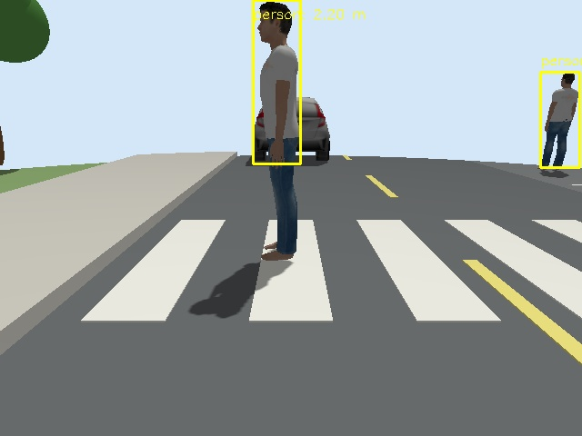
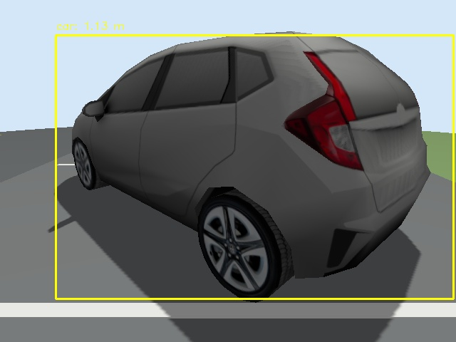

# Semantic stopping validation

Validated on 2026-11-15 with ROS 2 Jazzy, Gazebo Harmonic, the bundled OSRF textured assets, and `models/yolov8n.pt`. Perception confidence stayed at 0.35; no controller thresholds or class filters were changed for this asset replacement.

Before flight, Gazebo camera images were captured at the demo altitude and camera pitch. The central person was detected with confidence 0.807 at x=-5 m and 0.762 at x=-2.5 m. After comparing car viewpoints, the parked cars were set to yaw 0.785398 rad; the target car was detected at confidence 0.763 at x=4 m and 0.686 at x=4.3 m.

The full simulation, RGB-D perception, and controller were then run for each default demo in an isolated ROS domain and Gazebo partition. Gazebo ran with `gz_extra_args:=-s` using the display-backed renderer. Each run was stopped by the observer after a latched stop was reported.

| Demo | Observed progression | Final estimated target clearance | Forward command |
| --- | --- | --- | --- |
| Person | TAKEOFF → WAIT_PERCEPTION → CRUISE → APPROACH_person → STOP_person | 2.198 m | 0 m/s |
| Car | TAKEOFF → CRUISE → APPROACH_car → CRUISE → STOP_car | 1.128 m | 0 m/s |

The car temporarily returned to CRUISE during the approach as detection varied. These are two observed successful runs, not a guarantee of detection in every frame or on other hardware. Estimated clearances include the configured margin and image-age compensation; they are not independent ground-truth measurements. The person run required camera/model warmup before fresh perception became available.

Final status packets are preserved in [semantic-stops.json](semantic-stops.json). The images below are the latest annotated frames received by the observer when the stop was reported; image and status callbacks are asynchronous.

## Person

## Car

